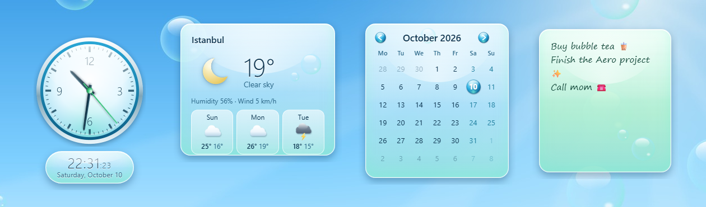

  

  <a href="#english">English</a> · <a href="#türkçe">Türkçe</a>

  <a href="../../releases/latest"><b>⬇️ Download / İndir</b></a>

  

---

## English

Glossy, Frutiger Aero–style desktop widgets for Windows. Bubbles, glass and sky blue, just like the good old days. 🫧

### ✨ Widgets

| | |
|---|---|
| 🕐 **Clock** | Glossy analog clock with a smooth second hand, digital time and date |
| ⛅ **Weather** | Live temperature, humidity, wind and a 3-day forecast. Click the city name to change it |
| 📅 **Calendar** | Month view with today marked by an aqua bubble. Double-click the month to jump back to today |
| 📝 **Notes** | A mint glass sticky note that saves automatically |

### 🖱️ How to use

- **Drag** a widget from any empty spot; its position is remembered.
- Hover over a widget and click the red **×** to hide it.
- **Right-click the tray icon** (the aqua orb next to the clock) to show/hide widgets or quit.
- Widgets stay on the desktop layer, behind your other windows.

### 📦 Installation

1. Download `Aero.Widgets_x.x.x_x64-setup.exe` from the [Releases](../../releases/latest) page.
2. Run it and complete the setup.
3. Open **Aero Widgets** from the Start menu.

> Don't want to install anything? Download `Aero.Widgets.portable.exe` and run it directly.

> If Windows SmartScreen shows an "unrecognized app" warning, click **More info → Run anyway**. This is normal because the app is not digitally signed.

### © License

This app is not open source. The source code is private and all rights are reserved.
You are free to download and use the app for personal use.

---

## Türkçe

Windows için parlak, Frutiger Aero tarzı masaüstü widget'ları. Baloncuklar, cam ve gökyüzü mavisi, tıpkı eski güzel günlerdeki gibi. 🫧

### ✨ Widget'lar

| | |
|---|---|
| 🕐 **Saat** | Akıcı saniye ibreli parlak analog saat, dijital saat ve tarih |
| ⛅ **Hava durumu** | Anlık sıcaklık, nem, rüzgâr ve 3 günlük tahmin. Şehir adına tıklayıp değiştirebilirsin |
| 📅 **Takvim** | Ay görünümü, bugün aqua baloncukla işaretli. Ay adına çift tıklayınca bugüne döner |
| 📝 **Not** | Otomatik kaydeden nane yeşili cam not kâğıdı |

### 🖱️ Kullanım

- Widget'ı boş bir yerinden tutup **sürükle**; konumu hatırlanır.
- Widget'ın üzerine gelip kırmızı **×** ile gizle.
- Widget'ları açıp kapatmak ya da çıkmak için **tepsi ikonuna sağ tıkla** (saatin yanındaki aqua küre).
- Widget'lar masaüstü katmanında, diğer pencerelerin arkasında durur.

### 📦 Kurulum

1. [Releases](../../releases/latest) sayfasından `Aero.Widgets_x.x.x_x64-setup.exe` dosyasını indir.
2. Çalıştır ve kurulumu tamamla.
3. Başlat menüsünden **Aero Widgets**'ı aç.

> Kurulum yapmak istemiyorsan `Aero.Widgets.portable.exe` dosyasını indirip doğrudan çalıştırabilirsin.

> Windows SmartScreen "tanınmayan uygulama" uyarısı verirse **Ek bilgi → Yine de çalıştır** seçeneğine tıkla. Uygulama dijital olarak imzalanmadığı için bu uyarı normaldir.

### © Lisans

Bu uygulama açık kaynak değildir. Kaynak kodu gizlidir ve tüm hakları saklıdır.
Uygulamayı kişisel kullanım için ücretsiz indirip kullanabilirsin.

---

## 🛠️ Built with / Kullanılan teknolojiler

- [Tauri 2](https://tauri.app/) (Rust)
- HTML, CSS, JavaScript
- Weather data / Hava durumu verisi: [Open-Meteo](https://open-meteo.com/)

Made with 💙 by <a href="https://github.com/K4YR">K4YR</a> · <a href="https://k4yrdev.com">k4yrdev.com</a>

